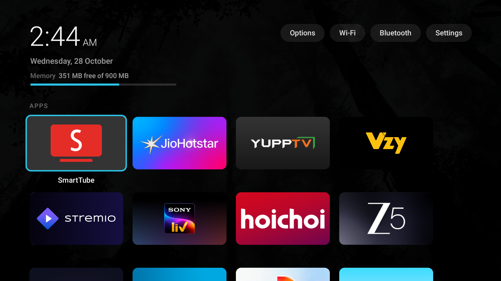
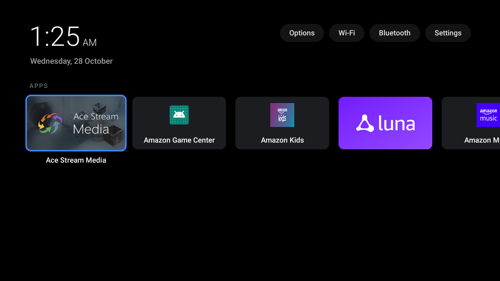
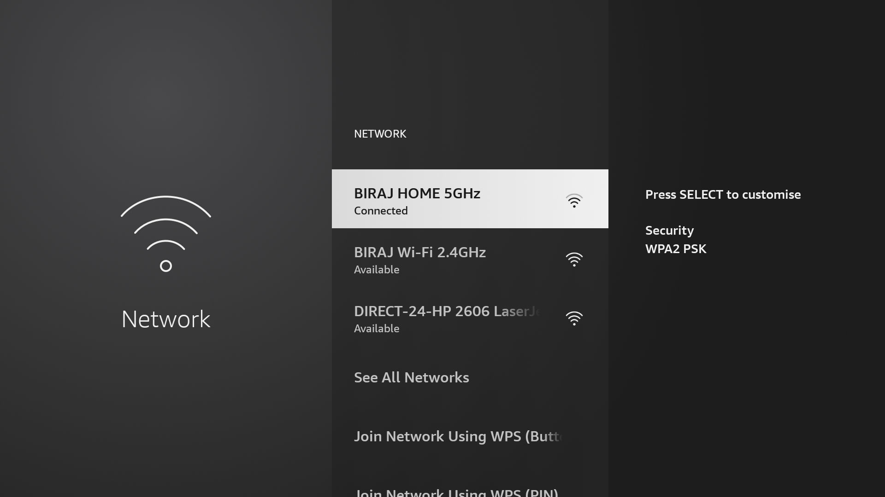
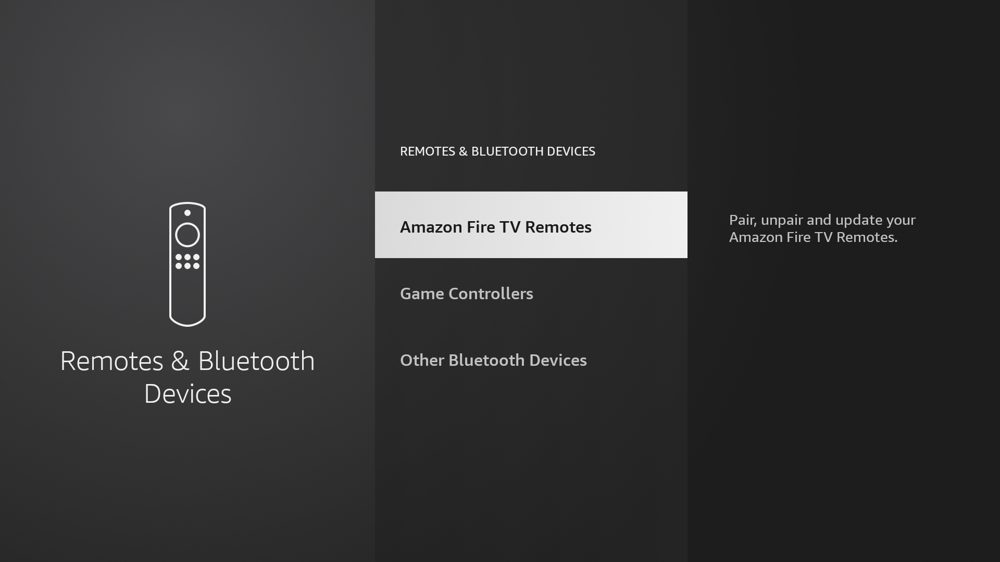
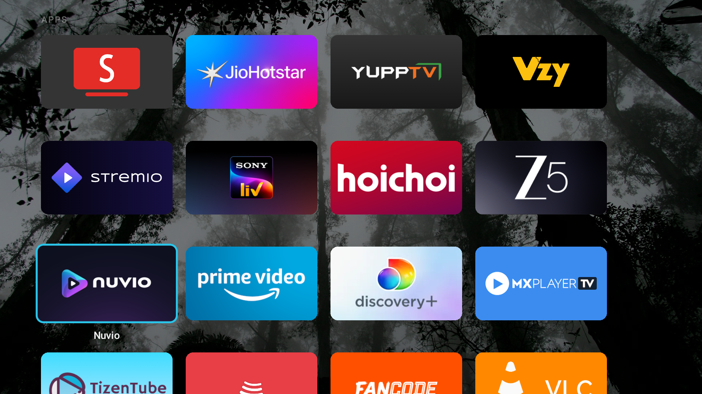
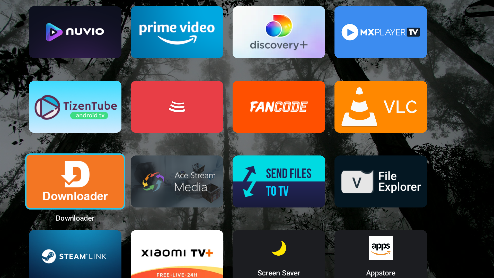
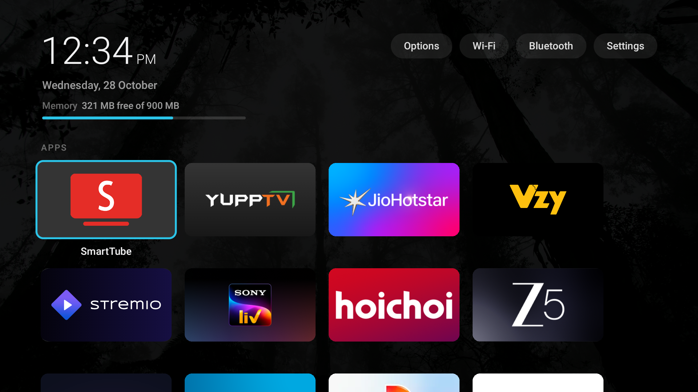

<div align="center">

# Clean My Fire TV
### Convert Any Amazon Fire TV from Bloated to High-Performance

[](LICENSE)
[](#universal-hardware-support)
[-3DDC84?logo=android&logoColor=white)](#universal-hardware-support)
[](dumbtv-enhanced-home-v1.0.1.apk)
[-7C4DFF)](#memory-and-resource-benchmark)
[](#prerequisites)
[](#100-reversibility-and-rollback)
[](https://1.1.1.1)

<p align="center">
  A high-performance, bloat-free, ad-free transformation suite for Amazon Fire TV Sticks, Fire TV Cubes, and Xiaomi Fire TV Smart TVs.<br>
  Replaces invasive Amazon ad interfaces with an ultra-lightweight custom launcher, optimizes memory headroom by over 700%, and guarantees complete reversibility through a transactional rollback engine.
</p>

<p align="center">
  <a href="MASTER_PROMPT.md"><b>Master Agent Prompt</b></a> •
  <a href="#quick-start-and-execution-guide"><b>Execution Guide</b></a> •
  <a href="guide/FIRETV_GUIDE.md"><b>Remote User Guide</b></a> •
  <a href="IMPLEMENTATION.md"><b>Implementation Log</b></a> •
  <a href="guide/ACTIVE_APPS_AND_SERVICES.md"><b>Services Inventory</b></a> •
  <a href="guide/COMPLETE_AUDIT_AND_REFERENCES.md"><b>Architectural Audit</b></a> •
  <a href="SECURITY.md"><b>Security Policy</b></a>
</p>

</div>

---

<h2 align="center">Visual Showcase</h2>

<div align="center">

| Page 1: Primary Streaming Hub | Header Navigation and Quick Access |
|:---:|:---:|
| <br><sub><b>Page 1</b>: SmartTube, JioHotstar, YuppTV, Vzy, Stremio, Sony LIV, Hoichoi, Zee5</sub> | <br><sub><b>Header Chips</b>: [ Options ], [ Wi-Fi ], [ Bluetooth ], [ Settings ] with live clock and RAM meter</sub> |

| Wi-Fi Quick Access Overlay | Bluetooth Devices Quick Access Overlay |
|:---:|:---:|
| <br><sub><b>Wi-Fi Settings</b>: Native Fire OS network configuration opened directly from header pill</sub> | <br><sub><b>Bluetooth Overlay</b>: Controllers and audio devices management opened directly from header pill</sub> |

| Page 2: Secondary Media Hub | Page 3: Utilities and Gaming Suite |
|:---:|:---:|
| <br><sub><b>Page 2</b>: Nuvio TV, Prime Video, discovery+, MX Player TV, TizenTube Cobalt, BitChord TV, FanCode, VLC</sub> | <br><sub><b>Page 3</b>: Downloader, Ace Stream Media, Send Files to TV, File Explorer, Steam Link, Xiaomi TV+, Appstore</sub> |

| Universal Verification on Live Hardware | Ambient Dark Wallpaper Mode |
|:---:|:---:|
| <br><sub><b>Live Hardware Verification</b>: Active DumbTV Home v1.0.1 on Fire TV Stick 3rd Gen</sub> | <br><sub><b>Ambient Wallpaper</b>: High-resolution dark forest backdrop calibrated with 90% dim overlay</sub> |

</div>

---

<h2 align="center">Key Capabilities</h2>

- **Zero Ads and Zero Promotions**: Eliminates autoplay video trailers, sponsored carousels, recommendation overlays, and background shopping daemons.
- **Universal Hardware Support**: Calibrated out-of-the-box for all Fire TV Sticks (Lite through 4K Max Gen 2), Fire TV Cubes (Gen 1-3), and Xiaomi Fire TVs / Fire OS Smart TVs.
- **700% RAM Boost**: Reclaims memory from ~45 MB to **~370 MB available RAM** by shedding 51 background telemetry, metric-upload, and consumer daemons.
- **Exclusive Custom Launcher**: Powered by [`dumbtv-enhanced-home-v1.0.1.apk`](dumbtv-enhanced-home-v1.0.1.apk) (`tv.dumbtv.home`):
  - **Universal Guard**: Bytecode pattern matches all Fire OS home activity signatures (`HomeActivity`, `HomeActivity_vNext`, `TvHomeActivity`) for instantaneous less than 150ms interception.
  - **Fire OS 8 Compatibility**: Injected `QUERY_ALL_PACKAGES` permission so third-party sideloaded apps always appear on Android 11+.
  - **Hardware Remote Settings Key**: Dedicated handler for physical Settings buttons (`KEYCODE_SETTINGS` / 176) found on Xiaomi and Alexa Voice Remote Pro remotes.
  - **4-Chip Quick Navigation**: Direct access header pills for `[ Options ]`, `[ Wi-Fi ]`, `[ Bluetooth ]`, and `[ Settings ]` with 3-tier fallback.
  - **Curated Ambient Wallpaper**: High-resolution forest background with a 90% dark overlay (`dim=90`).
  - **Live HUD Metrics**: Displays 12-hour AM/PM clock, date, and real-time hardware memory bar directly on the dashboard.
- **Airtight Amazon Home Suppression**: Stock Amazon home never flashes or appears on boot, wake, or app exit, while retaining explicit access whenever desired via `[ Options ] -> Open Amazon's home screen`.
- **Full App Lifecycle Control**: Newly installed apps automatically append to the grid; long-pressing remote `OK` or `Menu` enables reordering, renaming, hiding, and instant uninstallation.
- **Private DNS Hardening**: Enforces native Cloudflare DNS-over-TLS (`1dot1dot1dot1.cloudflare-dns.com`) at the system level.
- **100% Reversible**: Every modification is recorded with exact inverse shell operations in `logs/journal.jsonl`.

---

<h2 align="center">Universal Hardware Support</h2>

<div align="center">

| Device Category | Specific Models Supported | Firmware and Base OS |
|:---|:---|:---|
| **Fire TV Sticks** | • Fire TV Stick Lite (`karat`)<br>• Fire TV Stick 2nd Gen / Basic (`tank`)<br>• Fire TV Stick 3rd Gen (`sheldonp`)<br>• Fire TV Stick 4K 1st Gen (`mantis`)<br>• Fire TV Stick 4K Max 1st Gen (`kara`)<br>• Fire TV Stick 4K 2nd Gen (`cinelli`)<br>• Fire TV Stick 4K Max 2nd Gen (`karnak`) | • Fire OS 5 (Android 5.1 / SDK 22)<br>• Fire OS 6 (Android 7.1 / SDK 25)<br>• Fire OS 7 (Android 9.0 / SDK 28)<br>• Fire OS 8 (Android 11 / SDK 30) |
| **Fire TV Cubes** | • Fire TV Cube 1st Gen (`raven`)<br>• Fire TV Cube 2nd Gen (`gazelle`)<br>• Fire TV Cube 3rd Gen (`scudo`) | • Fire OS 6 (Android 7.1)<br>• Fire OS 7 (Android 9.0)<br>• Fire OS 8 (Android 11) |
| **Xiaomi Fire TVs and Smart TVs** | • Xiaomi Smart TV F2 Fire TV Series (43", 50", 55")<br>• Redmi Smart TV Fire TV Series (32", 43")<br>• Amazon Fire TV Omni / Omni QLED / 4-Series / 2-Series<br>• Insignia and Toshiba Fire TV Edition Smart TVs | • Fire OS 6, 7 and 8<br>• Physical HDMI 1/2/3/eARC inputs<br>• Live over-the-air antenna TV |

</div>

---

<h2 align="center">Curated 24-App Home Grid</h2>

Applications are structured in the battle-tested, user-curated operational layout:

<div align="center">

| Row | Applications (Left to Right) |
|:---:|:---|
| **Row 1** | **[SmartTube](https://github.com/yuliskov/SmartTube)** • **JioHotstar** • **YuppTV** • **Vzy** |
| **Row 2** | **[Stremio](https://www.stremio.com/)** • **Sony LIV** • **Hoichoi** • **Zee5** |
| **Row 3** | **Nuvio TV** • **Prime Video** • **discovery+** • **MX Player TV** |
| **Row 4** | **[TizenTube Cobalt](https://github.com/reisxd/TizenTubeCobalt)** • **[BitChord TV](https://github.com/kushagrasinghx/BitChord)** • **FanCode** • **VLC Media Player** |
| **Row 5** | **Downloader** • **Ace Stream Media** • **Send Files to TV** • **File Explorer** |
| **Row 6** | **Steam Link** • **Xiaomi TV+** • **Screen Saver** • **Amazon Appstore** *(Pinned End)* |

</div>

---

<h2 align="center">Quick Start and Execution Guide</h2>

### Prerequisites
1. **Host Computer**: Any system running Python 3.8+ (Windows, macOS, or Linux). Zero third-party pip packages required.
2. **Fire TV Developer Settings**:
   - Navigate to *Settings > My Fire TV > Developer Options*.
   - Turn **ADB Debugging** to **ON**.
   - *(If Developer Options is hidden, navigate to Settings > My Fire TV > About and click your device name 7 times continuously).*

---

### Method 1: Using the Master Prompt Only (AI-Driven Gated Workflow)

If you are using an AI coding assistant (Antigravity, Claude Code, Cursor, or Gemini CLI), you do not need to manually run commands.

1. Open [`MASTER_PROMPT.md`](MASTER_PROMPT.md).
2. Copy the entire markdown content.
3. Paste the prompt directly into your AI coding assistant.
4. The assistant will guide you through a step-by-step **gated interview**:
   - **Gate 0 (Discovery)**: Identifies your Fire TV model, Fire OS version, and initial RAM baseline.
   - **Gate 1 (Backup)**: Takes a full pre-clean snapshot and writes a standalone restore script.
   - **Gate 2 (Apps Audit)**: Asks what bloatware to uninstall and hide, recommending the curated defaults.
   - **Gate 3 (Third-Party Ecosystem)**: Checks for and installs SmartTube, Stremio, VLC, and other power-user streaming apps.
   - **Gate 4 (Debloat)**: Disables 50+ background telemetry and update daemons while safeguarding HDMI inputs and remotes.
   - **Gate 5 (Speedup & Privacy)**: Configures Cloudflare DoT DNS, cuts UI animations to 0.5x, and silences video ads.
   - **Gate 6 (Launcher)**: Deploys DumbTV Home v1.0.1, configures ambient wallpaper, and binds instant 0ms Home takeover.
   - **Gate 7 (Verification)**: Runs 11 automated verification tests and displays before-and-after RAM improvements.

---

### Method 2: Repository Clone and Local CLI Execution

If you prefer to run the tools locally from your terminal:

#### 1. Clone the Repository
```bash
git clone https://github.com/Biraj2004/clean-my-firetv.git
cd clean-my-firetv
```

#### 2. Run the Optimization Suite

**Windows (1-Click)**:
Double-click [`run.bat`](run.bat) or run from PowerShell / Command Prompt:
```cmd
run.bat
```

**macOS / Linux (1-Click)**:
```bash
chmod +x run.sh
./run.sh
```

**Direct Python CLI**:
```bash
# Launch interactive terminal menu
python main.py

# Automated non-interactive full optimization
python main.py --all

# Modular execution flags
python main.py --launcher    # Deploy DumbTV Home v1.0.1 (auto-fetches release APK)
python main.py --debloat     # Strip telemetry, ads and Alexa listening daemons
python main.py --optimize    # Apply Cloudflare DoT DNS and 0.5x snappy animations
python main.py --lockdown    # Starve background OTA update daemons
python main.py --dnsfilter   # Deploy personalDNSfilter local ad and OTA blocking engine
python main.py --backup      # Generate pre-clean state snapshot
python main.py --audit       # Run live post-clean health, RAM and service audit
python main.py --sanity      # Run 11-step automated verification suite
python main.py --rollback    # Restore entire device from journal
python main.py --ip <IP>     # Specify target device IP explicitly
```

---

<h2 align="center">100% Reversibility and Rollback</h2>

Every forward ADB shell command is committed as a transactional record in `logs/journal.jsonl` with an exact inverse operation.

```bash
# Full Factory Rollback: Restore entire device back to original state
python scripts/rollback.py --all

# Modular Rollbacks: Revert specific categories only
python scripts/rollback.py --category debloat      # Re-enable disabled Amazon apps
python scripts/rollback.py --category settings     # Revert stock settings and ad tracking
python scripts/rollback.py --category launcher     # Restore stock Amazon home launcher
python scripts/rollback.py --category alexa        # Re-enable Alexa listening services
```

---

<h2 align="center">Memory and Resource Benchmark</h2>

```text
+------------------------------------------------------------------------+
| PRE-CLEAN FREE RAM   : [##........] ~45 - 56 MB                        |
| POST-REBOOT FREE RAM  : [#######...] ~362.3 MB (40.2% Total Available)  |
+------------------------------------------------------------------------+
```

- **Usable System RAM**: 900.7 MB
- **Pre-Clean Free Memory**: ~45-56 MB (Device under persistent memory strain)
- **Post-Reboot Free Memory**: **362.3 MB (40.2% Total Free)**
- **Net Headroom Gained**: **+312.3 MB unreserved RAM** (+700% memory boost for 4K video buffering, Stremio playback, and zero background app kills).
- **Suppressed Heavy Daemons**: `com.amazon.firebat` (DEAD, -86 MB), `com.amazon.aca` (DEAD, -40 MB), `com.amazon.ceviche` (DEAD, -15 MB), `com.amazon.tv.forcedotaupdater.v2` (DEAD).

---

<h2 align="center">Documentation Index</h2>

- [**Master Agent Prompt**](MASTER_PROMPT.md): Single gated AI prompt to transform any Fire TV from bloated to high-performance.
- [**Remote User Guide**](guide/FIRETV_GUIDE.md): Remote control button shortcuts, quick settings access, and daily tile management.
- [**Active Apps and Services Inventory**](guide/ACTIVE_APPS_AND_SERVICES.md): Breakdown of all 24 apps, resident Android daemons, and RAM allocations.
- [**Complete Architectural Audit**](guide/COMPLETE_AUDIT_AND_REFERENCES.md): In-depth comparison with [dumbtv.org/blocked](https://dumbtv.org/blocked), safety whitelists, and AppOps telemetry starvation.
- [**Implementation Journal**](IMPLEMENTATION.md): Complete chronological audit log, smali bytecode patches, and universal hardware architecture.
- [**Security Policy**](SECURITY.md): Privacy assurances, network security model, and vulnerability reporting.
- [**License**](LICENSE): Standard open-source MIT License.

---

<h2 align="center">Repository Structure</h2>

```text
clean-my-firetv/
├── .github/
│   ├── workflows/ci.yml             # Cross-platform GitHub Actions CI
│   ├── ISSUE_TEMPLATE/              # Bug report and feature request templates
│   └── PULL_REQUEST_TEMPLATE.md     # Standard PR checklist
├── assets/                          # Showcase screenshots and ambient wallpaper
│   ├── screenshot-home-page1.png
│   ├── screenshot-home-page2.png
│   ├── screenshot-home-page3.png
│   ├── screenshot-header-chips.png
│   ├── screenshot-wifi-overlay.png
│   ├── screenshot-bluetooth-overlay.png
│   ├── screenshot-universal-verification.png
│   └── wallpaper-dark-ambient.jpg
├── core/                            # Core engine modules
│   ├── adb.py                       # Universal ADB client (Auto-discovery, USB/Wi-Fi)
│   ├── journal.py                   # Transactional forward/reverse action logger
│   └── lists.py                     # Safe debloat lists and NEVER_DISABLE whitelists
├── docs/                            # Reserved for web documentation deployment
│   └── .gitkeep
├── guide/                           # Technical reference guides & manuals
│   ├── ACTIVE_APPS_AND_SERVICES.md  # Inventory of 24 apps and system services
│   ├── COMPLETE_AUDIT_AND_REFERENCES.md # Deep architectural audit & dumbtv comparisons
│   ├── FIRETV_GUIDE.md              # Remote control user manual & visual showcase
│   └── IMPLEMENTATION.md            # Technical specifications & change history
├── scripts/                         # Phase-specific execution scripts
│   ├── backup.py                    # Pre-clean state snapshots
│   ├── debloat.py                   # Safe debloat engine
│   ├── optimize.py                  # Settings and privacy tuning
│   ├── lockdown.py                  # Soft OTA block and AppOps starvation
│   ├── dnsfilter.py                 # personalDNSfilter deployment & hard OTA/telemetry block
│   ├── launcher.py                  # DumbTV Home v1.0.1 deployment (auto-fetches release APK)
│   ├── inspect_services.py          # Android service records analyzer
│   ├── post_reboot_audit.py         # Live health and memory audit
│   ├── sanity_test.py               # 11-step automated verification suite
│   └── rollback.py                  # 100% reversible undo engine
├── home.conf                        # 24-app layout and visual configurations
├── main.py                          # Unified CLI entry point and interactive menu
├── MASTER_PROMPT.md                 # Single comprehensive prompt for AI agents
├── run.bat                          # 1-click Windows launcher
├── run.sh                           # 1-click macOS / Linux launcher
├── requirements.txt                 # Zero-dependency specification
├── IMPLEMENTATION.md                # Master implementation changelog
├── SECURITY.md                      # Security and privacy policy
└── LICENSE                          # MIT License
```

<div align="center">

**[Clean My Fire TV](https://github.com/Biraj2004/clean-my-firetv)** • Maintained by [Biraj Sarkar](https://github.com/Biraj2004) • Built upon [DumbTV](https://dumbtv.org/)

</div>
