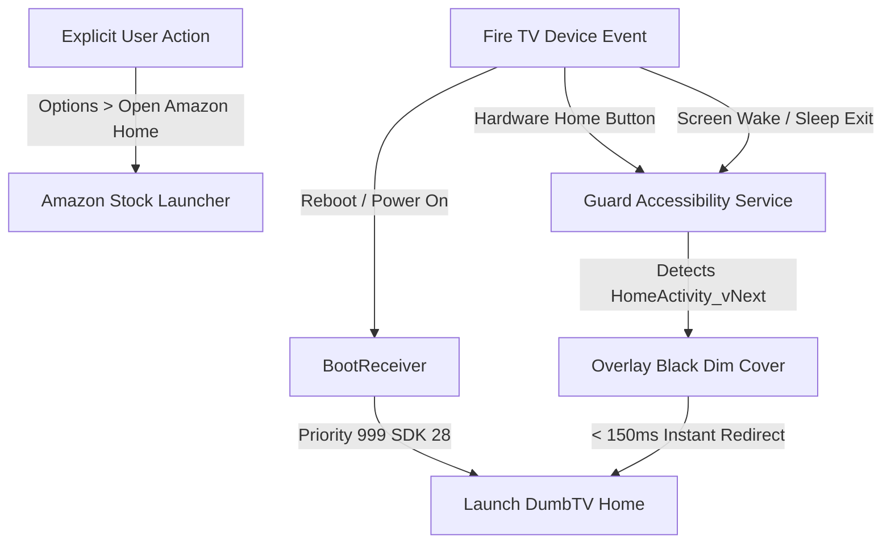

# Clean My Fire TV

[](file:///e:/01.%20GitHub%20Repo%20Projects/clean-my-firetv/LICENSE)
[](https://github.com/topics/firetv)
[%20SDK%2028-3DDC84?logo=android&logoColor=white)](https://android.com)
[](file:///e:/01.%20GitHub%20Repo%20Projects/clean-my-firetv/dumbtv-enhanced-home.apk)
[-7C4DFF)](#)
[](#)
[](https://1.1.1.1)

A high-performance, bloat-free, ad-free transformation for Amazon Fire TV Sticks. Replaces invasive Amazon ad interfaces with an ultra-lightweight custom launcher, optimizes memory headroom by over 700%, and guarantees complete reversibility through a transactional rollback engine.

---

## Visual Showcase

| Home Screen Grid (Page 1) | Enhanced 4-Chip Header |
|---|---|
|  |  |

| Wi-Fi Quick Access | Bluetooth Quick Access |
|---|---|
|  |  |

---

## Key Capabilities

- **Zero Ads & Zero Promos**: Eliminates autoplay video trailers, sponsored carousels, and intrusive shopping tiles.
- **Universal Hardware Support**: Fully calibrated for Fire TV Stick (Lite, 2nd/3rd Gen, 4K, 4K Max 1 & 2), Fire TV Cube (Gen 1-3), and Xiaomi Fire TVs / Fire OS Smart TVs.
- **700% RAM Boost**: Frees memory from ~45 MB to **~370 MB available RAM** by shedding 51 telemetry and background consumer daemons.
- **Exclusive Custom Launcher**: Powered solely by [dumbtv-enhanced-home.apk](file:///e:/01.%20GitHub%20Repo%20Projects/clean-my-firetv/dumbtv-enhanced-home.apk) (`tv.dumbtv.home`):
  - **Universal Guard**: Matches all Fire OS home activity signatures (`HomeActivity`, `HomeActivity_vNext`, `TvHomeActivity`).
  - **Fire OS 8 Compatibility**: Package visibility fix (`QUERY_ALL_PACKAGES`) guarantees third-party apps surface on Android 11+.
  - **Hardware Remote Keys**: Dedicated handler for physical Settings key (`KEYCODE_SETTINGS` / 176) found on Xiaomi and Pro remotes.
  - **4-Chip Quick Navigation**: Direct access pills for `[ Options ]`, `[ Wi-Fi ]`, `[ Bluetooth ]`, and `[ Settings ]` with 3-tier fallback.
  - **Curated Ambient Wallpaper**: High-resolution forest background with a 90% dark overlay (`dim=90`).
  - **HUD Metrics**: Live 12-hour AM/PM clock, date, and real-time hardware memory bar.
- **Airtight Amazon Home Suppression**: Stock Amazon home never flashes or appears on boot, wake, or app exits, while retaining explicit access when desired.
- **Full App Lifecycle Control**: Newly installed apps automatically surface; long-press enables reordering, renaming, hiding, and instant uninstallation.
- **Private DNS Hardening**: Enforces native Cloudflare DNS-over-TLS (`1dot1dot1dot1.cloudflare-dns.com`) at the system level.
- **100% Reversible**: Every modification is tracked with inverse operations in [logs/journal.jsonl](file:///e:/01.%20GitHub%20Repo%20Projects/clean-my-firetv/logs/journal.jsonl).

---

## Home Screen App Grid

Applications are arranged in the precise, user-curated operational order:

| Row | Applications (Left to Right) |
|---|---|
| **Row 1** | **[SmartTube](https://github.com/yuliskov/SmartTube)** • **JioHotstar** • **YuppTV** • **Vzy** |
| **Row 2** | **[Stremio](https://www.stremio.com/)** • **Sony LIV** • **Hoichoi** • **Zee5** |
| **Row 3** | **Nuvio TV** • **Prime Video** • **discovery+** • **MX Player TV** |
| **Row 4** | **[TizenTube Cobalt](https://github.com/reisxd/TizenTubeCobalt)** • **[BitChord TV](https://github.com/kushagrasinghx/BitChord)** • **FanCode** • **VLC Media Player** |
| **Row 5** | **Downloader** • **Ace Stream Media** • **Send Files to TV** • **File Explorer** |
| **Row 6** | **Steam Link** • **Xiaomi TV+** • **Screen Saver** • **Amazon Appstore** *(Final)* |

> [!TIP]
> **Newly Installed Apps**: Any application installed in the future automatically appears on the grid right after the organized apps.

### App Tile Actions (Long-Press Remote `OK` or `Menu`):
- **Move**: Reposition the tile interactively anywhere across the grid.
- **Rename**: Assign a custom display title.
- **Hide**: Remove the tile from the home screen grid (adds to `apps.hide`).
- **App info**: Jumps directly to Fire OS system application settings to **Uninstall**, **Clear Cache**, or **Clear Data**.
- **Unhide Apps**: Click the top `[ Options ]` pill > **"Apps on home screen"** to toggle any hidden app back to the grid.

---

## Stock Home Interception Architecture

To ensure the Fire TV default home screen never takes over unexpectedly:



1. **Multi-Action Boot Interceptor (`BootReceiver`)**: `maxSdkVersion` constraints were stripped so Android 9 (Fire OS 7 / SDK 28) executes the receiver on `BOOT_COMPLETED`, `QUICKBOOT_POWERON`, and `LOCKED_BOOT_COMPLETED`, launching DumbTV Home immediately.
2. **Accessibility Guard Daemon (`Guard`)**: Continuously monitors window transitions with 0ms delay. The instant Amazon's `HomeActivity_vNext` attempts to take focus, Guard renders an invisible dark cover and redirects to DumbTV Home in under 150ms.
3. **Intentional Navigation Preserved**: Selecting `[ Options ]` > **"Open Amazon's home screen"** pauses the guard temporarily so you can browse the stock interface whenever explicitly intended.

---

## Quick Start

### 1. Prerequisites
- Python 3.8+ on host computer (Windows, macOS, or Linux).
- Fire TV connected to local Wi-Fi or USB with **ADB Debugging** enabled (*Settings > My Fire TV > Developer Options > ADB Debugging*).

### 2. Connect & Run Pipeline

**Windows (1-Click)**:
Double-click [`run.bat`](file:///e:/01.%20GitHub%20Repo%20Projects/clean-my-firetv/run.bat) or run from terminal:
```cmd
run.bat
```

**macOS / Linux (1-Click)**:
```bash
chmod +x run.sh
./run.sh
```

**Python CLI (Interactive or Flag Mode)**:
```bash
# Interactive Menu
python main.py

# Non-interactive automated execution
python main.py --all

# Modular execution flags
python main.py --launcher    # Install & configure DumbTV Home
python main.py --debloat     # Strip telemetry & bloatware
python main.py --optimize    # Apply privacy & performance settings
python main.py --lockdown    # Starve background OTA daemons
python main.py --audit       # Live health, RAM & service audit
python main.py --sanity      # Run automated verification suite
python main.py --rollback    # Emergency restore all changes
python main.py --ip <IP>     # Specify target device IP
```

---

## Reversibility & Rollback

Every single ADB action is committed to [logs/journal.jsonl](file:///e:/01.%20GitHub%20Repo%20Projects/clean-my-firetv/logs/journal.jsonl) with an exact undo command.

```bash
# Restore entire Fire TV back to original factory state
python scripts/rollback.py --all

# Revert specific categories only
python scripts/rollback.py --category debloat      # Restore disabled apps
python scripts/rollback.py --category settings     # Restore stock settings & ads
python scripts/rollback.py --category launcher     # Restore stock launcher
python scripts/rollback.py --category alexa        # Re-enable Alexa listening daemons
```

---

## Documentation

- [User Remote Guide](file:///e:/01.%20GitHub%20Repo%20Projects/clean-my-firetv/guide/FIRETV_GUIDE.md): Remote control keybindings, quick settings access, and daily usage.
- [Active Apps & Services Inventory](file:///e:/01.%20GitHub%20Repo%20Projects/clean-my-firetv/docs/ACTIVE_APPS_AND_SERVICES.md): Full breakdown of all 24 apps, system daemons, and RAM allocations.
- [Complete Architectural Audit](file:///e:/01.%20GitHub%20Repo%20Projects/clean-my-firetv/docs/COMPLETE_AUDIT_AND_REFERENCES.md): In-depth comparison with [dumbtv.org/blocked](https://dumbtv.org/blocked), safety whitelists, and telemetry starvation.
- [Implementation Journal](file:///e:/01.%20GitHub%20Repo%20Projects/clean-my-firetv/IMPLEMENTATION.md): Complete technical changelog and bytecode modification logs.
- [Security Policy](file:///e:/01.%20GitHub%20Repo%20Projects/clean-my-firetv/SECURITY.md): Privacy assurances, network security model, and vulnerability reporting.

---

## Repository Structure

```
clean-my-firetv/
 assets/                               # Showcase screenshots and wallpaper asset
    dumbtv_home_rearranged_page1.png  # Showcase home screen grid (Page 1)
    dumbtv_home_rearranged_page2.png  # Showcase home screen grid (Page 2)
    dumbtv_home_rearranged_page3.png  # Showcase home screen grid (Page 3)
    dumbtv_enhanced_header.png        # Close-up of 4 navigation pills
    wifi_chip_clicked.png             # Direct Wi-Fi settings overlay
    bluetooth_chip_clicked.png        # Direct Bluetooth settings overlay
    img1-unsplash.jpg                 # Background wallpaper image
 core/
    adb.py                            # Dynamic ADB transport client
    journal.py                        # Transaction logger & rollback engine
    lists.py                          # Package definitions and safety whitelists
 docs/
    ACTIVE_APPS_AND_SERVICES.md       # Inventory of apps & running daemons
    COMPLETE_AUDIT_AND_REFERENCES.md  # Deep architectural audit & research sources
    IMPLEMENTATION.md                 # Complete development changelog
 guide/
    FIRETV_GUIDE.md                   # Remote control navigation guide
 home.conf                             # DumbTV Home configuration (dim 95, 24 apps)
 dumbtv-enhanced-home.apk              # Enhanced DumbTV Home launcher (4 chips + boot guard)
 LICENSE                               # MIT License file
 SECURITY.md                           # Security policy and privacy model
 IMPLEMENTATION.md                     # Comprehensive technical documentation
 main.py                               # Pipeline orchestrator
 scripts/                              # Modular phase scripts & rollback engine
```

---

## Credits & Acknowledgements

This project builds upon and integrates work from outstanding open-source projects and developer communities:

- **[DumbTV Home](https://dumbtv.org)**: Upstream minimal launcher designed by [dumbtv.org](https://dumbtv.org) / [dumbtv on GitHub](https://github.com/dumbtv). Clean My FireTV enhances it with dedicated Wi-Fi and Bluetooth navigation chips, 95% wallpaper dimming, and SDK 28 direct boot receivers.
- **[DumbTV Blocked Research](https://dumbtv.org/blocked)**: Upstream reference architecture for Fire OS telemetry starvation and protected package handling.
- **[SmartTube](https://github.com/yuliskov/SmartTube)**: Advanced open-source YouTube client for Android TV by Yurii Lisokovskiy ([Liskovsoft](https://github.com/yuliskov)).
- **[Stremio](https://www.stremio.com/)**: Modern media aggregation streaming platform.
- **[TizenTube Cobalt](https://github.com/reisxd/TizenTubeCobalt)**: Open-source Cobalt-based YouTube TV client by [reisxd](https://github.com/reisxd).
- **[BitChord TV](https://github.com/kushagrasinghx/BitChord)**: Open-source music and video player for Android TV by Kushagra Singh ([@kushagrasinghx](https://github.com/kushagrasinghx)).
- **[Cloudflare 1.1.1.1](https://1.1.1.1)**: High-performance Privacy-first DNS over TLS (DoT) provider.
- **[Unsplash](https://unsplash.com)**: Photography assets used for ambient background wallpaper.
- **Fire TV Community**: XDA Developers, AFTVNews, and the CleanYourTV project for telemetry research and safe debloat catalogs.

---

## License

This project is licensed under the MIT License - see the [LICENSE](file:///e:/01.%20GitHub%20Repo%20Projects/clean-my-firetv/LICENSE) file for details.
